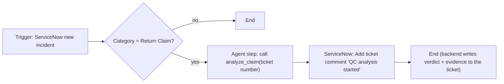

# Workflow Builder guide: "Return QC Triage"

**Design:** the workflow only *starts* the analysis. The QC backend writes the verdict,
reason codes, attribute checks and evidence image straight back to the ServiceNow
ticket when the background job finishes. So the workflow never waits on Argon, and GE's
~30 s tool timeout doesn't matter. Flagged claims appear in the Workbench queue
for the analyst.



## Build it (GE web app)
1. **Agents → + New agent → Start manually**.
2. **Trigger:** *App event* → **ServiceNow** → *New incident* (or *Record created* on `incident`).
3. **Add step → Condition:** `category` equals `return_claim`.
4. **Add step → Gemini Agent step** named *Start QC*:
   - Tools: add the **Return QC Workbench** MCP connector → allow `analyze_claim` only.
   - Instruction (paste):
     ```
     A new ServiceNow incident has arrived. Call the analyze_claim tool exactly once with
     claim_ref set to the incident number (e.g. INC0010041). Do not call any other tool.
     Reply with one line: "QC analysis started for <number>, job <job_id>".
     ```
5. **Add step → ServiceNow action → Add ticket comment**: incident = trigger's sys_id,
   work note = output of step 4.
6. **Preview** with a sample event → check that the ticket gets the "started" note, then the
   verdict note + `evidence_*.jpg` within ~1 min.
7. **Turn on** (Live). Optional: share with the QC analysts group.

## Optional second workflow: "Flagged claims digest"
- Trigger: **Schedule**, every 30 min.
- Agent step with the Workbench connector: "Summarize claims awaiting human review (route
  FLAGGED or HIGH_VALUE) with ticket numbers and reason codes."
- Action: **Google Chat → send message** to the QC team space.

## Demo tips
- Event triggers poll (5–10 min). Live in the meeting, use **`@Return QC Triage INC00xxxx`**
  in chat for an immediate run, or open the Workbench and click the claim.
- Pre-run all 19 claims before the meeting (Workbench → All claims → **Analyze pending**).
